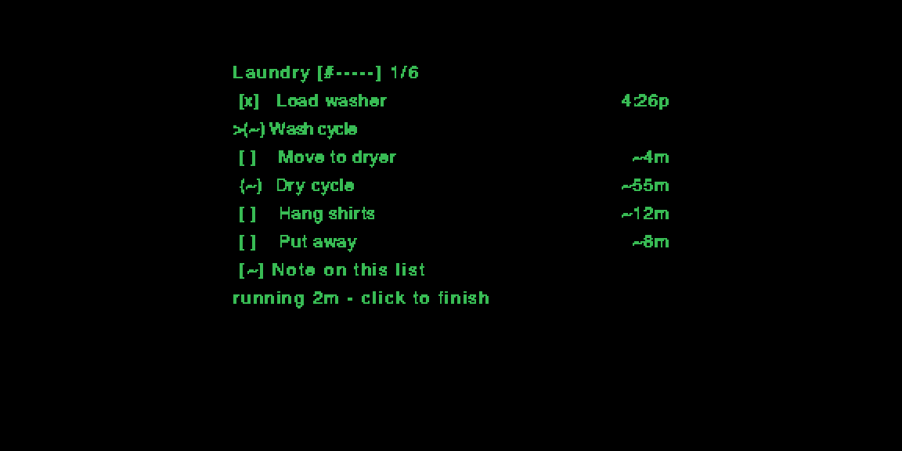
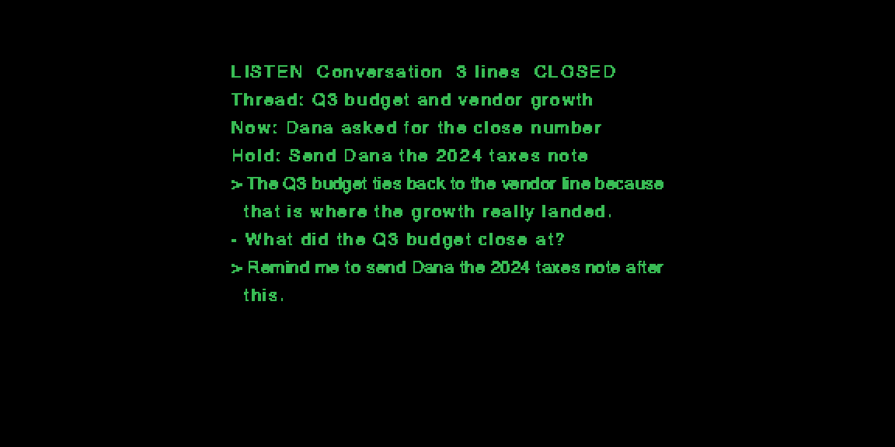

# WAM Assistant

> Historical milestone `v0.42.0`, based on face build `0.184.0`. Originally completed 2026-10-18; sanitized and published 2026-10-18. See [MILESTONE.md](MILESTONE.md) for this checkpoint.

WAM is a shared household assistant: the list, the chores and their timers in
one place, so the household doesn't live in one person's memory. It runs on a
phone, with Even G2 smart glasses as an optional heads-up display. The website,
with a fictional sample household, is at
<https://wam-in-progress.halebread5.chatgpt.site/>.

This repository is the glasses side: the Even G2 app and the local hub it talks
to. It began as a conversation assistant. Live speech becomes readable
paragraphs, a running conversation compass keeps the main thread, and brief
cues surface an answer, fact-check, follow-up or recap. It grew into a daily
heads-up display: a morning brief, the day's running order of chores with live
timers, voice notes reviewed before they are saved, and chat with AI assistants.

The household app itself, WAM Home, is developed in a separate private
repository. This snapshot keeps the shared Start Day rules and swaps the rest
for a plain-list stand-in, so the hub still runs on its own.

This repository is a sanitized portfolio edition. It contains synthetic
configuration and fixtures only. It does not contain personal conversations,
recordings, tasks, credentials, private server addresses, packaged apps, or the
private repository's Git objects.

WAM progressed through more than 100 documented on-device iterations. This
public history distills that work into 42 runnable milestones so the important
product and engineering turns remain reviewable without presenting every
diagnostic or one-line hardware build as a separate release.

## What it demonstrates

- A 576 x 288 heads-up display designed for fast glance reading
- A daily running order: hands-on steps and machine waits, live timers, and
  chore times learned from completed runs (a missing time stays blank)
- Local speech-to-text with an optional cloud fallback
- Thought-level transcript coalescing instead of treating audio chunks as sentences
- Running topics, recent points, summaries, and conversational recovery
- A phone control surface for modes, notes, and testing
- Pixel-measured layout for the glasses' proportional firmware font
- Four-panel redraw experiments balancing latency, flicker, and readability
- Idempotent capture, local persistence, retry-safe jobs, and privacy boundaries
- Source-backed spoken-work review with deliberate task promotion and crash-safe split/merge
- Simulator tooling, screen checks, tests, and guarded device releases

The engineering record is in `docs/HUD-LESSONS.md`. Its later sections are
written as incidents rather than advice — a release guard that could only see
half its input file and so let six stale builds ship; a wrapper that discarded
the one output stream carrying its subprocess's error messages; a background
service defeated by a platform permission that an interactive shell did not
hit. Each is the cheap version of a lesson that was not cheap to learn.

## Architecture

```text
glasses microphone and controls
            |
            v
phone WebView / Even SDK
            |
            v
local hub --> speech-to-text --> transcript and summaries
    |                                  |
    +--> durable notes and lists       +--> AI cue job
                                               |
                                               v
                                      local desktop model
                                               |
                                               v
                                  compact glasses HUD response
```

The hub stores state and queues bounded jobs. Speech and model processing can
run locally on the user's computer, keeping ordinary conversation audio away
from a hosted service. Cloud speech is an explicit opt-in fallback.

## Portability

The transcript, memory, summary, note, job, and cue layers do not depend on the
Even display. `glasses/` is the current device adapter: another wearable,
desktop overlay, phone client, or accessibility display can consume the same
hub APIs with its own renderer and controls. A new client mainly needs to map
its microphone and input events to the existing session endpoints and render
the returned transcript board and cues.

## Repository layout

- `glasses/`: Even G2 app, renderers, input handling, and simulator tools
- `server/`: local hub, transcript processing, notes, lists, and tests
- `agents/`: local model runner for AI cues and assistant turns
- `DEVLOG.md`: capability milestones
- `docs/HUD-LESSONS.md`: field notes — the display and font constraints, the
  list model, and a long section on the process and tooling mistakes that cost
  real time, with the incident behind each one
- `docs/SCREEN-RESEARCH.md`: how much of the panel the app actually uses, and
  the bandwidth ceiling that decides whether using more is affordable
- `docs/SIM-LOOP.md`: the four test loops, fastest to slowest, and what each
  one can and cannot prove
- `BUILD_HISTORY.md`: the complete documented device-build ledger
- `SANITIZATION.md`: source commit and export boundary for this snapshot
- `docs/SPOKEN-WORK-REVIEW.md`: an in-progress infrastructure case study with synthetic examples
- `docs/SPOKEN-WORK-DESTINATIONS.md`: a synthetic case study of proposal-only extraction and explicit destinations
- `docs/SPOKEN-WORK-GLASSES-REVIEW.md`: a synthetic case study of the compact glasses review and guarded voice amendments
- `docs/SPOKEN-WORK-MIGRATION.md`: a synthetic case study of verified-backup, resumable migration and manual-purge retention

## Try it

The quickest way to see WAM is the website's sample household, in the browser,
with no install, account or glasses: <https://wam-in-progress.halebread5.chatgpt.site/>.

On the glasses, the same day looks like this (rendered by the display code in
this repository, from synthetic data):





## Run the code

For reviewers who want to read and run the source. The portfolio snapshot
intentionally does not include a production package or private deployment
configuration.

```bash
npm --prefix server install
npm --prefix glasses install
npm test
npm --prefix server start
```

Hardware packaging needs the EvenHub SDK and a package identity registered by
the developer.

## Development disclosure

Development is AI-assisted. Mike owns the problem definition, product scope,
system design, interaction decisions, integration, field testing on the
hardware, debugging evidence, privacy choices, and release decisions. Claude
and Codex have been used as implementation collaborators. That collaboration is
documented because coordinating multiple agents safely became part of the
engineering work.

## License

All rights reserved. The source is published for portfolio review only; see
[LICENSE](LICENSE).
